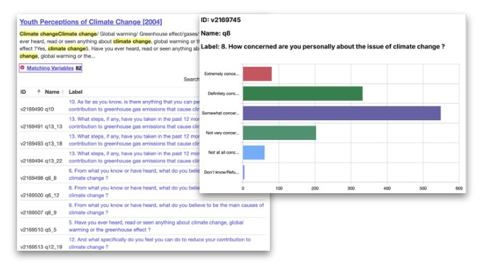
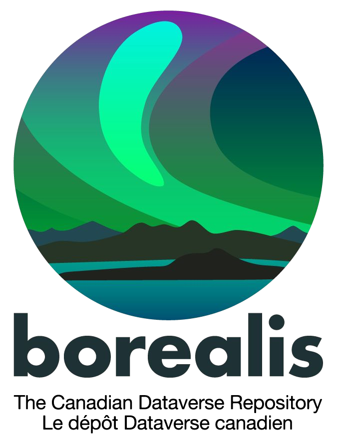
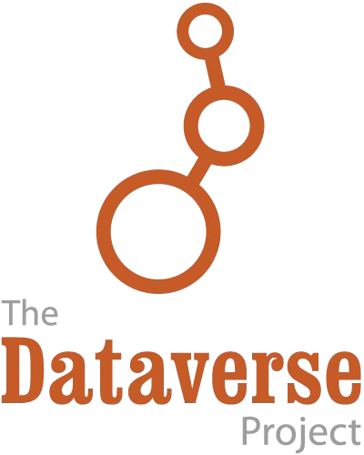

# 

**This use case highlights ways researchers can leverage Dataverse repositories to share social science data for reuse.**

---

## Dataset Details

**Dataset Title:** Youth Perceptions of Climate Change, 2004 [Canada]

**Citation:**

> Environment Canada; Ipsos Reid: 2023, "Youth Perceptions of Climate Change [2004]", <https://doi.org/10.5683/SP3/V95LVS>, Borealis, V2, UNF:6:nwaZR0v1WjP85CU4NwGJJg== [fileUNF]

**License:** CC BY-NC 4.0 (Non-commercial)

**Dataverse Tools & Previewers:**

- [Tabular File Ingest (TAB-delimited)](https://guides.dataverse.org/en/latest/user/tabulardataingest/index.html)
- [Supported Metadata](https://guides.dataverse.org/en/latest/user/appendix.html#metadata-references)
- [DDI Codebook PDF & HTML, XML, OAI-PMH](https://guides.dataverse.org/en/latest/user/dataset-management.html#metadata-export-formats)
- [Data Explorer: Variable Preview/Edit](https://guides.dataverse.org/en/latest/api/apps.html#data-explorer)
- [Data Variable Metadata API](https://guides.dataverse.org/en/latest/api/dataaccess.html#data-variable-metadata-access)

---

## Background

Since the mid-20th century, social science data sharing occurs at many academic institutions across the world. Open data management and curation of social science data requires transparency, reproducibility, considerations for long-term access and support for a variety of multidisciplinary qualitative and quantitative research data types, including survey and public opinion data, social, demographic, health, and economic data, census data, microdata, text, data simulations, linkages, models, etc.

### Data Type/Formats

CSV, Excel, SPSS SAV, STATA DTA, TXT, SAS, R, Python, etc.

### Sharing Recommendations

- Open, non-proprietary files & original file formats, coding, analysis, study documentation, file metadata, etc.
- Variable documentation (e.g. dictionaries, codebooks, questionnaires, user guides, code and category lists and definitions, etc.)
- Consideration of ethical research practices

### Additional Resources

- [Social Science Metadata](https://github.com/IQSS/dataverse/blob/master/scripts/api/data/metadatablocks/social_science.tsv)
- [Dataverse Metadata Crosswalk](https://docs.google.com/spreadsheets/d/1VAhZ83hKURX_4T-bOkn7XCb9h62Gr2gcJI1fWe4Rl4c/edit?gid=587531992#gid=587531992)
- [Odesi Metadata Best Practices](https://zenodo.org/records/10655425)

### Discovery & Access

- Tabular file ingest TAB-delimited
- Data previewers & curation tools
- Social science metadata description & open discovery standards (XML and JSON)

![Youth Perceptions of Climate Change [2004] dataset page in Borealis, showing the citation, description, keywords, license and file tree](images/youth-perceptions-dataset-page.jpg)

**Youth Perceptions of Climate Change, 2004 [Canada]**
*National public opinion poll of young Canadians (from 16 to 25 years of age) measuring their awareness, receptivity and behaviour on issues related to climate change.*

*Variables & Frequencies*

---

![Annotated screenshots of Dataverse features: "Tabular data ingest (.tab file) and download options" points to the Access Dataset menu with original-format and archival .tab ZIP downloads; "Display file folder hierarchies" points to the Tree view of a dataset's files; "File tags (data, code, documentation)"; "Customizable metadata collections facets" points to Frequency, Data Type and Language facets; "Advanced and variable searching and open metadata APIs (variableLabel:Smoking)" points to search results matching a variable label.](images/ingest-and-discovery-features.jpg)

---

## Citation, Geospatial, Social Science and Humanities Metadata

---

## Integrated Tool: Data Explorer

![Annotated screenshots of the Data Explorer tool for a 2001 Census file. Callouts: "Uses tabular file tool integration framework for explore and configure (editing)" points to Data Explorer in the Access File and Edit Options menus; "Preview summary frequencies and statistics" points to a bar chart of number of bedrooms; "Cross tabulate two or more variables", "Create Charts" and "Subset & download" point to the Cross Tabulation view; "Curators can add & edit variable metadata including label, question text, interviewer instructions, universe, notes, weights, etc." and "Edit & Save" point to the variable editing form.](images/data-explorer-tool.jpg)

---

  
  &nbsp;&nbsp;
  

**Borealis, Canadian Dataverse Repository / University of Toronto Dataverse** is a research data repository based on [the Dataverse Project](https://dataverse.org/) software, for faculty, students, and staff. Files are held in a secure environment on Canadian servers. Researchers can choose to make content available publicly or restrict access to files. For more information and FAQs visit our [guidance page on U of T Dataverse in Borealis](https://onesearch.library.utoronto.ca/researchdata/getting-started-u-t-dataverse).
